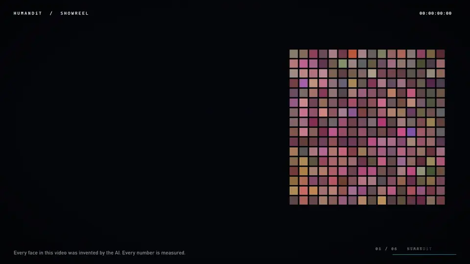

# Model card: HumanDiT

## Summary
HumanDiT generates **synthetic** 256×256 human faces, optionally conditioned on up to 12 face attributes. It is a
flow-matching diffusion transformer (DiT^DH-B, 183M parameters) working in the RAEv2 latent space, which consists
of frozen DINOv3-L features plus a ViT-XL pixel decoder. It is paired with one-step students (W-Flow and adversarial).

## Intended use
Research, education and portfolio demonstration of generative-model engineering. **Not for commercial use.**

## Out-of-scope and prohibited use
- Impersonating, identifying or making claims about real people. Generated faces are synthetic, but they may resemble
  real individuals by chance.
- Creating deceptive media (fake profiles, fraud, harassment, political disinformation).
- Any decision about people (hiring, lending, policing, biometric verification).

## Training data
- **FFHQ** (70,000 Flickr faces, CC BY-NC-SA 4.0), 256×256, with horizontal flips.
- **CelebA** attribute annotations (non-commercial research agreement), used only to train a linear probe that
  pseudo-labels FFHQ.

## Attribute labels
The probe abstains when uncertain: thresholds are calibrated on CelebA validation data for ≥90% precision
("present") and ≥97% negative predictive value ("absent"). Subjective or appearance-judgement attributes (for example
"Attractive") and skin tone are excluded. CelebA's binary "Male" label is a simplification of gender presentation
and does not represent gender identity.

The 12 attributes are Male, Eyeglasses, Hat, Goatee, Sideburns, Beard, Lipstick, Gray Hair, Bangs, Blond Hair,
Smiling and Mouth Open. Bald, Mustache and Wearing Necktie passed the CelebA accuracy bar but were dropped: fewer than
0.5% of FFHQ faces reach the 90%-precision threshold for them, so the generator could not learn them.

## Measured performance (teacher at 50 steps unless stated; details in the README)
- FID-50k vs FFHQ-256: **3.78** (clean) / 3.87 (legacy TF) at the tuned Internal Guidance scale 1.55, with
  FD_DINOv2 49.0, precision 0.819 and recall 0.680. The demo uses 1.55. At the pre-training default 1.78: 4.60 / 4.59,
  FD_DINOv2 62.4. The scale was tuned on FID-10k against the same reference, so 3.78 is not a held-out estimate.
- At the demo's 25 steps (same guidance): FID-50k **3.41** (clean) / 3.47 (legacy TF), FD_DINOv2 49.0, precision 0.819
  and recall 0.689. Fewer steps cost nothing here. The step count was also chosen on FID-10k against the same
  reference.
- Attribute control at the tuned IG 1.55 (CFG 2.0): 89.9% mean agreement of the DINOv3 probe with the requested
  attribute state (84.4% at the default 1.78). The probe over-fires on generated latents, because guidance inflates
  latent statistics (std 1.18 at IG 1.55 and 1.36 at 1.78, vs 1.03 for real data; `scripts/latent_stats.py`), so
  treat absolute rates as approximate.
- Memorisation: 0 of 10,000 teacher samples exceeded the 99.9th-percentile training-to-training similarity at either
  guidance scale, and neither did the fixed one-step GAN student. The most similar pairs show different people.
- One-step students (1 network evaluation, 20× faster than the 50-step teacher, far less diverse):
  - The fixed adversarial student has the best image statistics: FID-50k 20.0, FD_DINOv2 239, precision 0.728 and
    recall 0.339 (vs 0.680 for the teacher).
  - But it has lost facial-hair control. Asked for a goatee, sideburns or a beard, it renders them 0%, 10% and 11% of
    the time (teacher 99%, W-Flow 98–100%). Its mean attribute agreement is 84.5% vs 92.4% for W-Flow (same probe
    test, both on the laptop GPU; W-Flow scored 91.8% on the 4090). The cause is measured: its discriminator
    prefers the contradicting facial-hair label. An attribute-aware discriminator collapsed the student to one face
    and was stopped at step 500, so the limitation stands ([docs/gan_facial_hair.md](docs/gan_facial_hair.md)).
  - W-Flow reaches FID 23.0, FD_DINOv2 376 and recall 0.163.
  - The adversarial student's first run collapsed (FID 207, recall 0). An anchored retry reached FID 33.1. Both had
    a discriminator noise-level bug; fixing it alone produced the 20.0.
  - One training run each.
  - The demo's real-time mode uses the fixed GAN student. It warns when a requested attribute is one the student
    follows less than half the time, and the teacher handles all 12.

## Known biases and limitations
- FFHQ over-represents some age groups, ethnicities and photographic styles. Under-represented groups are likely to
  be generated with lower fidelity and less often. We report unconditional attribute base rates in the README.
- Attribute pseudo-labels inherit CelebA's annotation biases and the CelebA→FFHQ domain shift.
- Quality is measured with FID, FD_DINOv2 and precision/recall, which capture only part of perceptual quality.

## Safety measures
- Every demo image carries an invisible TrustMark watermark (Adobe, MIT licence, the neural watermark used in the
  Content Credentials ecosystem) and "AI-generated" PNG metadata (sampler, seed, attributes), and the demo includes a
  watermark checker. Measured on 128 generated faces, 64 from the teacher and 64 from the one-step GAN
  (`scripts/watermark_eval.py --device cuda`):
  - recovered after 100% of PNG, JPEG q75, JPEG q50, 2× rescaling and 90% crops;
  - PSNR 43 dB;
  - 0 false positives on 128 real and 128 unmarked faces.
  - The "Blend two faces" video frames are marked before H.264 encoding; all 16 frames of a test video still carried it.

  Until this release the PNG metadata was claimed but missing: the demo let Gradio re-encode the images, which drops
  text chunks. The demo now writes the PNGs itself, and the metadata was checked on downloaded files.

  A determined adversary can still remove it. The first implementation (DWT-DCT, invisible-watermark 0.2) failed
  this check (0 of 6 recovered) and was replaced.
- A memorisation audit compares 10k samples with all 70k training faces in DINOv3 space; results are in the README.

## Licences of components
Code: MIT. Files adapted from RAEv2: CC BY-NC 4.0. W-Flow loss ported from the MIT-licensed official code.
DINOv3 weights: DINOv3 License. Trained weights: non-commercial (CC BY-NC-SA 4.0, inherited from FFHQ).
