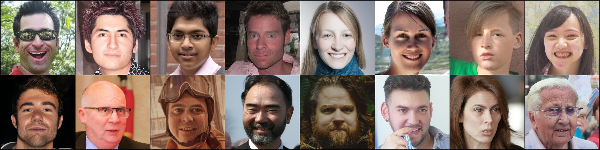
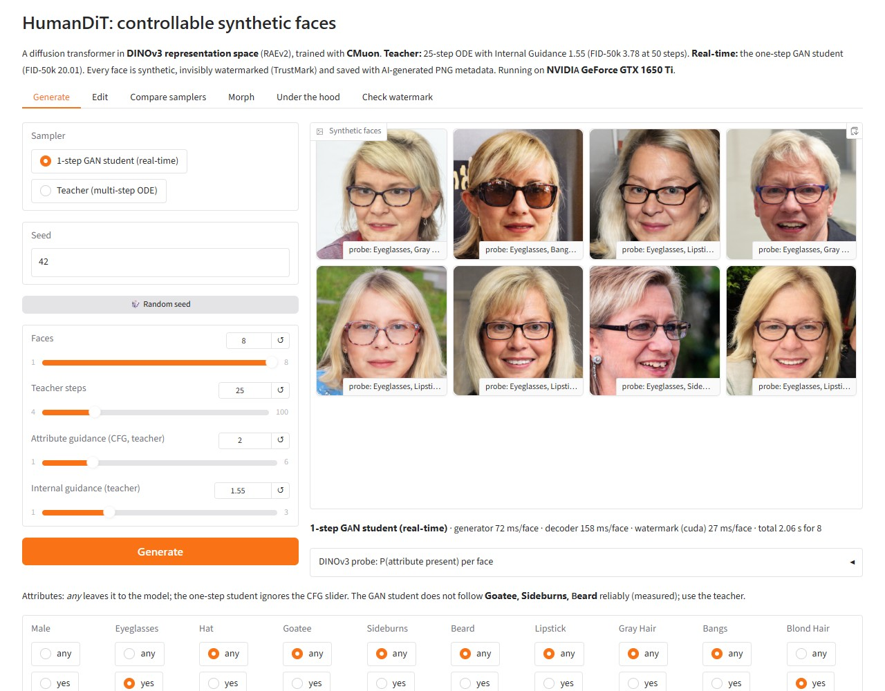
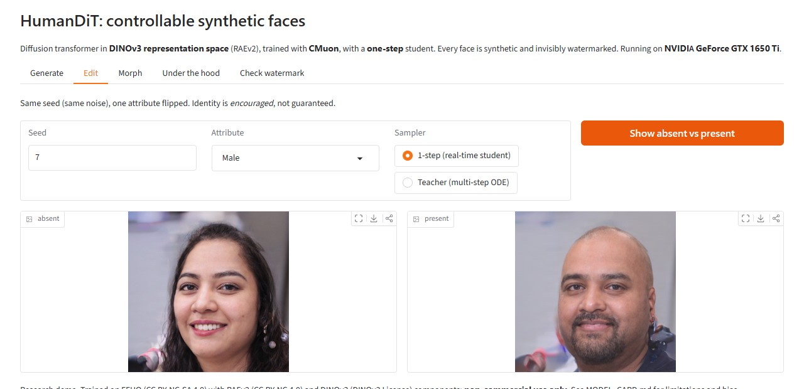
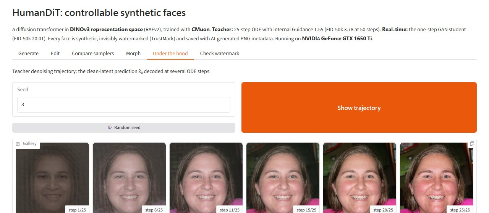
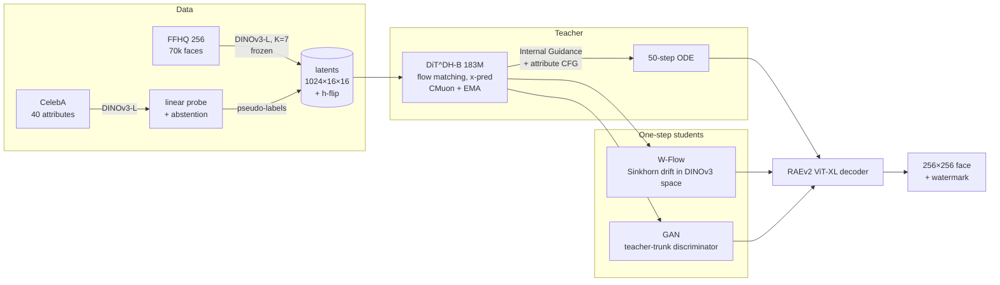
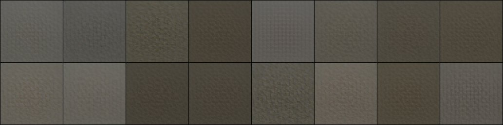
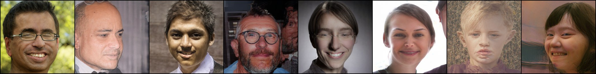

# HumanDiT: controllable synthetic faces in DINOv3 space

   

A 256×256 face generator you can steer with 12 attributes (smile, glasses, hat, beard, grey or blond hair, …). It
is built from the newest published methods at every stage, and every result below is measured by scripts in this
repo.


*Fixed seeds, not cherry-picked: 50-step teacher with Internal Guidance, final EMA weights. Top row: unconditional.
Bottom row: one attribute requested per face (male, eyeglasses, hat, goatee, sideburns, beard, lipstick, grey hair),
with attribute CFG 2.0. Every image is synthetic.*

| Stage | What | Why it matters |
|---|---|---|
| **Latent space** | [RAEv2](https://arxiv.org/abs/2605.18324) (Jun 2026): frozen **DINOv3-L** features (layers 11–23, K=7) + a ViT-XL pixel decoder | Diffusion happens in a *semantic* representation space rather than a VAE's, which RAEv2 shows converges ~10× faster |
| **Generator** | DiT^DH (trunk + wide DDT head), x-prediction flow matching, dimension-shifted logit-normal timesteps | The architecture RAEv2 uses for high-dimensional (1024-ch) latents |
| **Guidance** | [Internal Guidance](https://arxiv.org/abs/2512.24176): an auxiliary head at block 4 acts as the "weak model" | Guidance with no extra network and no extra forward pass; works unconditionally |
| **Optimiser** | [CMuon](https://arxiv.org/abs/2608.02502) (Aug 2026): Muon with *chunked* Polar-Express orthogonalisation of fused adaLN weights | Implemented from the paper's algorithms (no public code) and unit-tested |
| **Control** | One token per attribute (unspecified / absent / present), attribute CFG | Any subset of attributes can be requested; "all unspecified" is the unconditional model |
| **Computer vision** | DINOv3 linear-probe labeller trained on CelebA, with **calibrated abstention** | Pseudo-labels FFHQ, then scores the generator's own outputs *in latent space* |
| **One step** | [W-Flow](https://arxiv.org/abs/2605.11755) (May 2026) **vs** adversarial post-training (the GAN), head-to-head | ~50× fewer network evaluations; interactive on a 4 GB laptop GPU |
| **Responsibility** | Memorisation audit against all 70k training faces, invisible watermark, model card | Faces of real people are sensitive, so this is measured rather than assumed |

## Results

<!-- RESULTS:START -->
### Generation quality (FFHQ 256×256, 50,000 samples per model)

| Model | NFE | FID (clean) ↓ | FID (legacy TF) ↓ | FD_DINOv2 ↓ | Precision ↑ | Recall ↑ | img/s (4090, bs16) |
|---|---|---|---|---|---|---|---|
| Teacher, 50-step ODE + Internal Guidance 1.78 (default) | 50 | 4.60 | 4.59 | 62.4 | 0.787 | 0.683 | 14.5 |
| W-Flow student, 1 step | 1 | 23.01 | 23.29 | 376.2 | 0.688 | 0.163 | 286.3 |
| GAN student, adversarial only (1st attempt: **mode collapse**), 1 step | 1 | 206.87 | 204.91 | 2400.6 | 0.532 | 0.000 | 287.1 |
| *Before:* original DCGAN (bugs fixed), 64×64 | 1 | 177.60 | 172.09 | – | – | – | – |

The DCGAN generates 64×64 images, so the 256 px reference also penalises it for resolution. Scored at its own resolution against all 70k FFHQ faces downsampled to 64×64, its FID (clean) is **45.8**.

### Attribute control (teacher, CFG 2.0; scored by the DINOv3 probe on generated latents)

| Attribute | asked *present* → probe agrees | asked *absent* → probe agrees | base rate (unconditional) |
|---|---|---|---|
| Male | 72.7% | 89.1% | 48.2% |
| Eyeglasses | 88.3% | 85.9% | 27.3% |
| Hat | 88.3% | 89.1% | 15.9% |
| Goatee | 95.3% | 84.0% | 24.0% |
| Sideburns | 91.4% | 84.4% | 21.2% |
| Beard | 96.1% | 74.6% | 27.5% |
| Lipstick | 73.0% | 84.4% | 30.2% |
| Gray Hair | 95.3% | 74.2% | 24.0% |
| Bangs | 89.5% | 79.7% | 30.1% |
| Blond Hair | 75.4% | 82.8% | 17.0% |
| Smiling | 78.5% | 88.3% | 60.8% |
| Mouth Open | 84.0% | 81.6% | 55.7% |

Mean controllability accuracy: **84.4%**.

The probe over-fires on *generated* latents. For the rarer attributes (hat, goatee, sideburns, gray hair, blond hair) it calls 16%–24% of unconditional samples positive, while FFHQ has 3%–9%. Internal Guidance extrapolation inflates latent statistics: latent std is 1.37 with guidance, vs 1.01 without it and 1.03 for real FFHQ latents (`scripts/latent_stats.py`). So the absolute percentages are approximate; the shift from the base-rate column is the controllable effect.

### Memorisation audit (DINOv3 space, 10,000 samples vs every training face)

- Nearest-training-face cosine similarity: generated median **0.58** (p99 0.79), vs training-to-training median 0.82 (p99 0.97).
- Fraction of samples closer to a training face than 99.9% of real faces are to each other: **0.000%**.
- Caveat: generated faces sit *further* from the training set than real faces sit from each other. That is partly the same guidance-induced shift in latent statistics, so this feature space understates similarity. The direct evidence is below: the 8 **most similar** pairs out of 10,000 share pose and studio style, but show different people.


### CPU-only deployment (ONNX Runtime, laptop CPU, batch 1)

| Graph | max abs error vs PyTorch | ONNX Runtime ms/face | eager PyTorch ms/face | size |
|---|---|---|---|---|
| 1-step generator | 2.3e-05 | 751 | 952 | 726 MB |
| RAEv2 decoder | 1.0e-05 | 1531 | 1913 | 1667 MB |
| decoder, weight-only int8, block 32 (MatMulNBits) | PSNR 44.5 dB vs fp32 | 2699 | – | 474 MB |

Dynamic int8 (activations quantised too) broke the ViT-XL decoder in testing (9–11 dB): its activation outliers need per-block weight-only quantisation. Weight-only int8 is 3.5× smaller but not faster on this CPU.

### Invisible watermark on every demo output (TrustMark Q (BCH text payload), 64 generated faces)

| PNG | JPEG q75 | JPEG q50 | 2× down/up-scale | 90% centre crop | PSNR | false positives (real / unmarked) |
|---|---|---|---|---|---|---|
| 100% | 100% | 95.3% | 100% | 100% | 43.4 dB | 0% / 0% |

### RAEv2 decoder on faces (reconstruction gate)

PSNR **27.2 dB**, LPIPS **0.033**, rFID **1.30** on 10,000 FFHQ images with the released ImageNet-trained decoder, no face fine-tuning.

### DINOv3 attribute probe (CelebA official test split)

| Attribute | Balanced acc. | AUROC | FFHQ labelled present / absent / abstain |
|---|---|---|---|
| Male | 0.990 | 0.999 | 63% / 37% / 0% |
| Eyeglasses | 0.988 | 0.995 | 22% / 78% / 0% |
| Hat | 0.978 | 0.995 | 9% / 91% / 0% |
| Goatee | 0.962 | 0.987 | 5% / 92% / 3% |
| Sideburns | 0.954 | 0.987 | 7% / 93% / 1% |
| Beard | 0.948 | 0.988 | 10% / 90% / 0% |
| Lipstick | 0.942 | 0.987 | 26% / 69% / 5% |
| Gray Hair | 0.941 | 0.982 | 3% / 97% / 0% |
| Bangs | 0.935 | 0.983 | 11% / 86% / 4% |
| Blond Hair | 0.934 | 0.982 | 4% / 94% / 3% |
| Smiling | 0.923 | 0.979 | 64% / 31% / 5% |
| Mouth Open | 0.916 | 0.972 | 57% / 35% / 8% |

### Training cost

Teacher: 46,708 steps, 11.96M samples, 10.8 h on NVIDIA GeForce RTX 4090 (182.9M params, bfloat16).

<!-- RESULTS:END -->

## Live demo (runs on a 4 GB laptop GPU)

`uv run --extra demo python app/gradio_app.py` starts a Gradio app on the
GTX 1650 Ti laptop. It uses the teacher, the 1-step W-Flow student and the probe, and falls back to ONNX Runtime on
CPU-only machines. The screenshots below are taken by [`scripts/demo_screenshots.py`](scripts/demo_screenshots.py),
driving the real app in Edge.

**Generate:** 8 one-step faces for *female + eyeglasses + blond + smiling*. Timings are on the laptop: the generator
takes 28 ms/face, the RAEv2 decoder 200 ms/face and the TrustMark watermark 378 ms/face on the CPU. The probe's
confidence for every attribute of every face is listed underneath.



**Edit** (same seed, one attribute flipped) and **Under the hood** (the teacher's clean-image prediction across the
ODE; note the over-saturation that Internal Guidance adds in the last steps, quantified in the results):




The **Morph** tab renders a spherical interpolation between two seeds as a video. The **Check watermark** tab detects
the invisible mark in any uploaded image.

## How it works



## Engineering notes (all measured)

- **The laptop GPU dictated the precision policy.** On the GTX 1650 Ti (TU117, sm_75), fp16 GEMM runs at
  **0.41 TFLOPS vs 1.72 in fp32** (no tensor cores), and bf16 is emulated. The code runs fp32 on sm_75 and bf16 +
  `torch.compile` on Ampere and newer. See [docs/hardware_notes.md](docs/hardware_notes.md).
- **Decoder rewrite:** the RAEv2 pixel decoder is re-implemented with SDPA attention. It loads the released weights
  strictly and matches the reference to **2.4e-7** max abs error.
- **Reconstruction gate before spending money:** the released "general" decoder reconstructs FFHQ faces at PSNR
  27.2 dB / LPIPS 0.033 (500 images on the laptop). No face-specific decoder fine-tuning was needed.
- **4 GB laptop smoke test:** DiT^DH-S learns faces from 256 images in 1.8 h. Its samples are measurably close to
  the training set (as an overfit test should be), and Internal Guidance visibly sharpens them. See the
  [write-up with figures](docs/laptop_smoke_test.md).
- **Budget-aware training:** the trainer measures its own step time and fits the run to a dollar budget.
  Gradient accumulation backs off automatically on OOM, and every stage of the RunPod pipeline is idempotent and resumable.
- **W-Flow adaptation:** the paper computes OT drift in MAE feature spaces. Here the RAEv2 latent *is* a DINOv3
  representation, so the multi-scale drift (tokens, 2×2 and 4×4 pools, global statistics) runs directly on
  generator outputs with no extra feature network. The loss is ported from the official MIT implementation.

## What broke, and how I fixed it

Everything below happened during this project's single cloud run. Each fix is in the code and measured.

| Problem | How it showed up | Fix |
|---|---|---|
| **A pod idled for 19 h (about $7)** | A Community 4090 passed `nvidia-smi` but `cuInit` failed. Setup died, and the pipeline only stopped the pod after a *successful* run. | Host check before any work: `cuInit`, a bf16 GEMM floor (rejects the common 150 W power-capped 4090s: 69–79 vs about 150 TFLOPS) and a verified self-stop path. The pod stops itself 20 min after any failure, and a deadman stops it at the dollar budget. |
| **5 of 12 attributes were untrainable** | Bald, goatee, grey hair and others had 0.0% "present" labels on FFHQ. The class-balanced probe only reaches 90% precision above p=0.99, and the threshold grid stopped at 0.99. | Calibrate on every validation probability, and drop attributes the teacher cannot see in both states. Now goatee has 5.2% present and grey hair 2.9%, with smiling, blond hair and mouth open back-filled. |
| **FID crashed on the pod** | Python 3.14 made `forkserver` the Linux default, so clean-fid's DataLoader can't pickle its resize closure. It passed on Windows only because Windows uses 0 workers. | One `cleanfid()` helper: fork workers on Linux, plus the SciPy 1.18 `sqrtm` patch (which was also missing from one call site). |
| **Grey samples at 1M training samples** | The EMA half-life of 1.4M samples has no warm-up, so 61% of the EMA was still the zero-initialised output layer. | Checked the raw weights instead: they already made faces after 40 min. Documented, not "fixed", so results come from the exact code that ran. |
| **W-Flow OOM at batch 128** | In eager mode, the teacher, EMA and AdamW states plus activations exceeded 24 GB. | Activation checkpointing for the student and the discriminator trunk: peak 10.9 GiB (W-Flow) and 7.6 GiB (GAN). |
| **The GAN student collapsed to one face** | FID 207, recall 0. The discriminator sat at chance, since a per-sample D on re-noised latents cannot see missing diversity. | Second attempt with a pseudo-Huber anchor to 6,144 teacher ODE pairs (results below). |
| **The watermark didn't work** | `invisible-watermark` DWT-DCT recovered 0 of 6 marks on 256 px faces and changed pixels by up to 179 levels. | Replaced it with TrustMark: 100% recovery after PNG, JPEG q75, rescaling and cropping, 43 dB PSNR, and 0 false positives (`scripts/watermark_eval.py`). |

| EMA, 1.0M samples | raw weights, 0.72M samples |
|---|---|
|  |  |

## Reproduce

```bash
uv sync --extra eval --extra demo                       # Python 3.14, torch 2.14 (cu130); PYTHONUTF8=1 on Windows (TrustMark sdist)
uv run pytest                                           # unit tests
uv run python scripts/rae_reconstruction_gate.py --n 500
uv run python scripts/train.py configs/laptop_smoke.yaml            # 4 GB smoke test
DRY_RUN=1 EXTRAS=1 bash scripts/pod/run_all.sh          # the whole cloud pipeline on tiny data, locally

# the real run: rent a healthy 4090, ship the code, run everything under a dollar cap, pull the results
uv run python scripts/pod_ops.py launch --budget 5.5 --auto-reject
uv run python scripts/pod_ops.py logs
uv run python scripts/pod_ops.py pull && uv run python scripts/pod_ops.py mark-pulled

uv run python scripts/make_report.py                    # rebuilds the results section from runs/**/*.json
uv run python legacy/dcgan.py train && uv run --extra eval python legacy/dcgan.py fid    # "before" baseline
uv run python scripts/latent_stats.py --ckpt runs/teacher_b/ckpt/ema.safetensors
uv run --extra demo python scripts/watermark_eval.py
uv run --extra demo python scripts/export_onnx.py --student runs/student_wflow/student.safetensors --int8
uv run --extra demo python app/gradio_app.py            # live demo
```

## Before → after

| | Original project | HumanDiT |
|---|---|---|
| Model | DCGAN (2015), 64×64 | RAEv2 latent diffusion transformer, 256×256 |
| Quality (FID-50k vs FFHQ-256, clean) | **177.6** (45.8 at its own 64 px) | **4.60** (teacher) · 23.0 (1-step student) |
| Control | none | 12 face attributes, any subset (84% probe agreement) |
| Sampling | 1 step (GAN) | 50-step teacher **and** a 1-step student, 20× faster |
| Evaluation | none | FID, FD_DINOv2, precision/recall, controllability, memorisation, ablations |
| Safety | none | measured watermark, memorisation audit, model card |
| Engineering | one script, duplicated folder, CPU-only torch | package, tests, CI, spend-guarded resumable cloud pipeline, ONNX export |

The original code is preserved in [`legacy/`](legacy/), and [`legacy/README.md`](legacy/README.md) explains its flaws. One example:
its "latent consistency" loss penalised output differences between nearby latents, which *encourages* mode collapse.

## Limitations (honest)

- FFHQ is skewed in age, ethnicity and photographic style, and the generator inherits that skew. Attribute labels are
  CelebA-derived pseudo-labels (e.g. a binary "Male" label), so they are a simplification.
- Results are not SOTA: the best published FFHQ-256 FIDs are about 2–3, from far larger compute budgets. The teacher
  trained for 10.8 h on one RTX 4090 (12M samples).
- The one-step student is 20× faster but much worse (FID 23.0 vs 4.60, recall 0.16 vs 0.68): 45 min of W-Flow
  distillation trades diversity for speed. It is a pure one-step model (more steps make it worse; see the ablation).
  W-Flow here is my adaptation (drift in the RAEv2 latent itself, teacher initialisation), not the paper's exact setup.
- The first GAN student failed (mode collapse). It is reported, not hidden.
- Internal Guidance at the default scale 1.78 inflates latent statistics by about a third. That inflates the probe's
  attribute rates and lowers the memorisation-audit similarities (both explained next to those numbers). The guidance
  sweep shows how much FID it costs.

## Licences

The code is MIT (see [LICENSE](LICENSE)); files adapted from RAEv2 keep their **CC BY-NC 4.0** notice. Trained
weights inherit **non-commercial** terms from FFHQ (CC BY-NC-SA 4.0), RAEv2 (CC BY-NC 4.0) and DINOv3 (DINOv3 License).
See [MODEL_CARD.md](MODEL_CARD.md).
