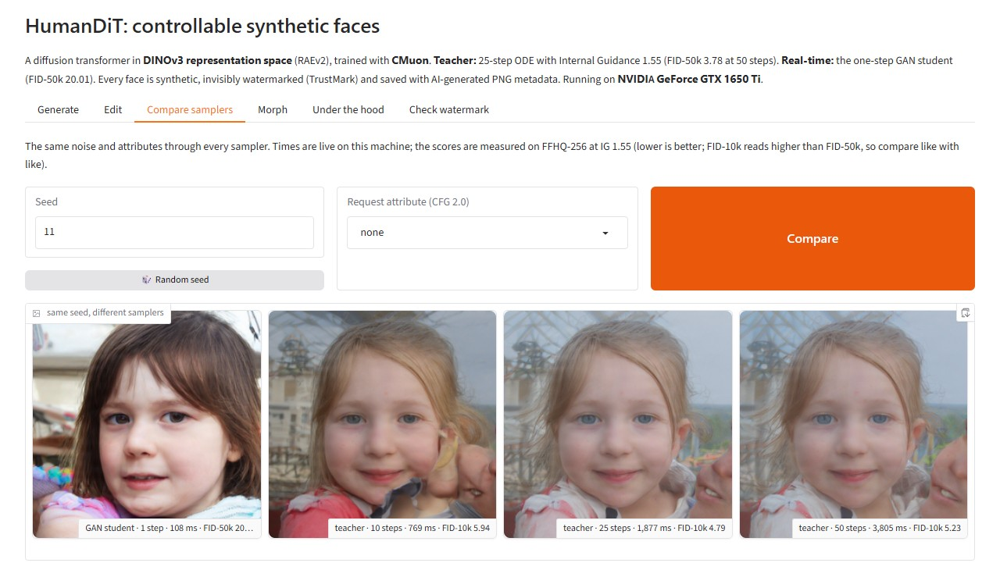
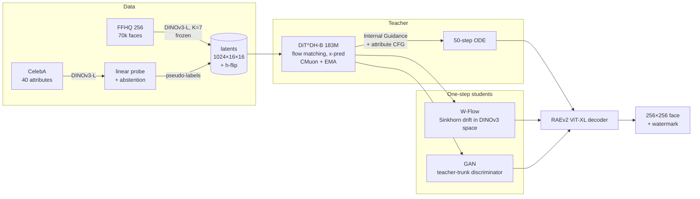

# HumanDiT: controllable synthetic faces in DINOv3 space

   

A 256×256 face generator you can steer with 12 attributes (smile, glasses, hat, beard, grey or blond hair, …). It
is built from the newest published methods at every stage, and every result below is measured by scripts in this
repo.


*Fixed seeds, not cherry-picked: 50-step teacher with the tuned Internal Guidance scale 1.55, final EMA weights. Top
row: unconditional. Bottom row: one attribute requested per face (male, eyeglasses, hat, goatee, sideburns, beard,
lipstick, grey hair), with attribute CFG 2.0. Every image is synthetic. Rendered by
[`scripts/hero_grid.py`](scripts/hero_grid.py) with the trainer's own sample seeds.*

| Stage | What | Why it matters |
|---|---|---|
| **Latent space** | [RAEv2](https://arxiv.org/abs/2605.18324) (Jun 2026): frozen **DINOv3-L** features (layers 11–23, K=7) + a ViT-XL pixel decoder | Diffusion happens in a *semantic* representation space rather than a VAE's, which RAEv2 shows converges ~10× faster |
| **Generator** | DiT^DH (trunk + wide DDT head), x-prediction flow matching, dimension-shifted logit-normal timesteps | The architecture RAEv2 uses for high-dimensional (1024-ch) latents |
| **Guidance** | [Internal Guidance](https://arxiv.org/abs/2512.24176): an auxiliary head at block 4 acts as the "weak model" | Guidance with no extra network and no extra forward pass; works unconditionally |
| **Optimiser** | [CMuon](https://arxiv.org/abs/2608.02502) (Aug 2026): Muon with *chunked* Polar-Express orthogonalisation of fused adaLN weights | Implemented from the paper's algorithms (no public code) and unit-tested |
| **Control** | One token per attribute (unspecified / absent / present), attribute CFG | Any subset of attributes can be requested; "all unspecified" is the unconditional model |
| **Computer vision** | DINOv3 linear-probe labeller trained on CelebA, with **calibrated abstention** | Pseudo-labels FFHQ, then scores the generator's own outputs *in latent space* |
| **One step** | [W-Flow](https://arxiv.org/abs/2605.11755) (May 2026) **vs** adversarial post-training (the GAN), head-to-head | ~50× fewer network evaluations; interactive on a 4 GB laptop GPU |
| **Responsibility** | Memorisation audit against all 70k training faces, invisible watermark, model card | Faces of real people are sensitive, so this is measured rather than assumed |

## Results

<!-- RESULTS:START -->
### Generation quality (FFHQ 256×256, 50,000 samples per model)

| Model | NFE | FID (clean) ↓ | FID (legacy TF) ↓ | FD_DINOv2 ↓ | Precision ↑ | Recall ↑ | img/s (4090, bs16) |
|---|---|---|---|---|---|---|---|
| **Teacher, 50-step ODE + Internal Guidance 1.55 (tuned)** | 50 | 3.78 | 3.87 | 49.0 | 0.819 | 0.680 | – |
| Teacher, 50-step ODE + Internal Guidance 1.78 (default) | 50 | 4.60 | 4.59 | 62.4 | 0.787 | 0.683 | 14.5 |
| **GAN student + anchor, discriminator fixed (3rd attempt), 1 step** † | 1 | 20.01 | 20.55 | 239.1 | 0.728 | 0.339 | – |
| W-Flow student, 1 step | 1 | 23.01 | 23.29 | 376.2 | 0.688 | 0.163 | 286.3 |
| GAN student + teacher-pair anchor (2nd attempt, discriminator bug), 1 step | 1 | 33.08 | 32.14 | 504.6 | 0.630 | 0.155 | 287.2 |
| GAN student, adversarial only (1st attempt: **mode collapse**), 1 step | 1 | 206.87 | 204.91 | 2400.6 | 0.532 | 0.000 | 287.1 |
| *Before:* original DCGAN (bugs fixed), 64×64 | 1 | 177.60 | 172.09 | – | – | – | – |

FID: clean-fid against FFHQ-256 trainval70k. FD_DINOv2: Fréchet distance in DINOv2 ViT-L/14 CLS space vs all 70k FFHQ faces. Precision/recall: k-NN (k = 3) coverage in the same DINOv2 space, 10k generated vs 10k real.

† Trained and scored on a Colab A100-SXM4-40GB (same code, data, steps and bf16 policy as the 4090 rows); its speed was not timed. A measured bake-off showed that GPU choice does not move these metrics ([docs/compute_platforms.md](docs/compute_platforms.md)). The only change from the 2nd attempt is the discriminator noise-level fix.

The DCGAN generates 64×64 images, so the 256 px reference also penalises it for resolution. Scored at its own resolution against all 70k FFHQ faces downsampled to 64×64, its FID (clean) is **45.8**.

The tuned row uses the guidance scale that won the FID-10k sweep below (1.55), re-scored on 50,000 samples. Only the guidance scale differs, so its speed equals the default's. Attribute control and latent statistics below are also at the tuned 1.55, with the default 1.78 for comparison.

### Attribute control (teacher, IG 1.55, CFG 2.0; scored by the DINOv3 probe on generated latents)

| Attribute | asked *present* → probe agrees | asked *absent* → probe agrees | base rate (unconditional) |
|---|---|---|---|
| Male | 70.3% | 97.3% | 45.5% |
| Eyeglasses | 94.1% | 94.9% | 23.7% |
| Hat | 94.5% | 93.4% | 12.7% |
| Goatee | 98.8% | 89.5% | 19.8% |
| Sideburns | 98.8% | 89.5% | 17.6% |
| Beard | 99.2% | 82.4% | 24.1% |
| Lipstick | 82.4% | 86.3% | 32.3% |
| Gray Hair | 97.7% | 80.9% | 18.9% |
| Bangs | 94.9% | 88.3% | 24.9% |
| Blond Hair | 84.0% | 85.2% | 13.7% |
| Smiling | 84.8% | 91.0% | 62.4% |
| Mouth Open | 90.2% | 90.2% | 55.7% |

Mean controllability accuracy: **89.9%**. At the default IG 1.78 it was 84.4%.

The probe over-fires on *generated* latents. For the rarer attributes (hat, goatee, sideburns, gray hair, blond hair) it calls 13%–20% of unconditional samples positive, while FFHQ has 3%–9%. Internal Guidance extrapolation inflates latent statistics: latent std is 1.18 at IG 1.55, vs 1.02 without guidance and 1.03 for real FFHQ latents (1.36 at the default 1.78) (`scripts/latent_stats.py`). So the absolute percentages are approximate; the shift from the base-rate column is the controllable effect.

One-step students (one network evaluation, so no CFG), same test on the demo laptop (GeForce GTX 1650 Ti, fp32): fixed GAN **84.5%**, W-Flow **92.4%** mean agreement. W-Flow scored 91.8% on the 4090 in bf16.

### Memorisation audit (DINOv3 space, 10,000 samples vs every training face)

- Nearest-training-face cosine similarity: generated median **0.58** (p99 0.79), vs training-to-training median 0.82 (p99 0.97).
- Fraction of samples closer to a training face than 99.9% of real faces are to each other: **0.000%**.
- Caveat: generated faces sit *further* from the training set than real faces sit from each other. That is partly the same guidance-induced shift in latent statistics, so this feature space understates similarity. The direct evidence is below: the 8 **most similar** pairs out of 10,000 share pose and studio style, but show different people.
- At the tuned guidance scale (1.55), the generated median is 0.71 (p99 0.86), closer to the training-set statistics as the caveat predicts, and 0.000% of samples exceed the threshold.
- The fixed one-step GAN student: generated median 0.77 (p99 0.87), and 0.000% of samples exceed the threshold.


### Ablation: Internal Guidance scale (teacher, 50 steps, FID-10k clean)

| IG scale | 1.00 | 1.30 | 1.55 | 1.78 |
|---|---|---|---|---|
| FID-10k ↓ | 9.01 | 6.41 | **5.23** | 6.08 |

FID-10k is biased upwards relative to FID-50k; compare within this table only.

### Quality vs network evaluations (FID-10k clean)

| Model | NFE | FID-10k ↓ |
|---|---|---|
| Teacher (IG 1.55) | 10 | 5.94 |
| Teacher (IG 1.55) | 25 | 4.79 |
| Teacher (IG 1.55) | 50 | 5.23 |
| Teacher (IG 1.78) | 10 | 5.58 |
| Teacher (IG 1.78) | 25 | 4.65 |
| Teacher (IG 1.78) | 50 | 6.08 |
| W-Flow student | 1 | 23.80 |
| W-Flow student | 2 | 28.47 |
| W-Flow student | 4 | 34.80 |

With IG 1.55, 25 steps score better than 50 (4.79 vs 5.23).

With IG 1.78, 25 steps score better than 50 (4.65 vs 6.08).

### CPU-only deployment (ONNX Runtime, laptop CPU, batch 1)

| Graph | max abs error vs PyTorch | ONNX Runtime ms/face | eager PyTorch ms/face | size |
|---|---|---|---|---|
| 1-step generator (fixed GAN) | 4.9e-05 | 825 | 1026 | 726 MB |
| RAEv2 decoder | 1.3e-05 | 1765 | 2151 | 1667 MB |
| decoder, weight-only int8, block 32 (MatMulNBits) | PSNR 44.4 dB vs fp32 | 3129 | – | 474 MB |

Dynamic int8 (activations quantised too) broke the ViT-XL decoder in testing (9–11 dB): its activation outliers need per-block weight-only quantisation. Weight-only int8 is 3.5× smaller but not faster on this CPU.

### Invisible watermark on every demo image (TrustMark Q (BCH text payload), 128 generated faces, teacher and one-step GAN, embedded on the GPU)

| PNG | JPEG q75 | JPEG q50 | 2× down/up-scale | 90% centre crop | PSNR | false positives (real / unmarked) |
|---|---|---|---|---|---|---|
| 100% | 100% | 100% | 100% | 100% | 43.1 dB | 0% / 0% |

### RAEv2 decoder on faces (reconstruction gate)

PSNR **27.2 dB**, LPIPS **0.033**, rFID **1.30** on 10,000 FFHQ images with the released ImageNet-trained decoder, no face fine-tuning.

### DINOv3 attribute probe (CelebA official test split)

| Attribute | Balanced acc. | AUROC | FFHQ labelled present / absent / abstain |
|---|---|---|---|
| Male | 0.990 | 0.999 | 63% / 37% / 0% |
| Eyeglasses | 0.988 | 0.995 | 22% / 78% / 0% |
| Hat | 0.978 | 0.995 | 9% / 91% / 0% |
| Goatee | 0.962 | 0.987 | 5% / 92% / 3% |
| Sideburns | 0.954 | 0.987 | 7% / 93% / 1% |
| Beard | 0.948 | 0.988 | 10% / 90% / 0% |
| Lipstick | 0.942 | 0.987 | 26% / 69% / 5% |
| Gray Hair | 0.941 | 0.982 | 3% / 97% / 0% |
| Bangs | 0.935 | 0.983 | 11% / 86% / 4% |
| Blond Hair | 0.934 | 0.982 | 4% / 94% / 3% |
| Smiling | 0.923 | 0.979 | 64% / 31% / 5% |
| Mouth Open | 0.916 | 0.972 | 57% / 35% / 8% |

### Training cost

Teacher: 46,708 steps, 11.96M samples, 10.8 h on NVIDIA GeForce RTX 4090 (182.9M params, bfloat16).

<!-- RESULTS:END -->

## Live demo (runs on a 4 GB laptop GPU)

`uv run --extra demo python app/gradio_app.py` starts a Gradio app on the GTX 1650 Ti laptop. It loads the teacher,
the one-step **fixed GAN** student and the probe, and falls back to ONNX Runtime on CPU-only machines. The screenshots
below are taken by [`scripts/demo_screenshots.py`](scripts/demo_screenshots.py), driving the real app in Edge. All
timings are on the laptop, warm and CUDA-synchronised.

**Generate:** 8 one-step faces for *female + eyeglasses + blond + smiling* in about 2 s. The generator takes
72–75 ms/face, the RAEv2 decoder 154–158 ms/face and the TrustMark watermark 21–35 ms/face. The watermark now runs on
the GPU; on the CPU it took 273 ms/face, more than the model itself. Each caption lists the attributes the DINOv3
probe detects in that face, with the full probabilities one click away. Every downloaded PNG carries "AI-generated"
metadata with its sampler, seed and attributes. If you request an attribute the loaded student measured below 50% on
(for the GAN: goatee, sideburns and beard), the demo says so and points to the teacher.


**Compare samplers:** the same noise through the one-step GAN and the teacher at 10, 25 and 50 steps, each captioned
with its live time and measured FID. On the laptop that is 108 ms, 0.77 s, 1.88 s and 3.81 s per face. The teacher
defaults to **25 steps** everywhere in the demo: at the tuned guidance it scored better than 50 on FID-10k (4.79 vs
5.23) in half the time. The headline FID-50k (3.78) was measured at 50 steps, and 25 steps were only scored on 10k
samples. For this seed the GAN draws a different child than the teacher does: its training ties only its anchor
noises to teacher outputs, so a new seed need not map to the teacher's face.



**Edit** shows one attribute requested absent, left to the model, and present, from the same noise. **Under the
hood** shows the teacher's clean-image prediction across the ODE; note the over-saturation that Internal Guidance adds
in the last steps, quantified in the results. It also has the measured-metrics table and the memorisation audit.


The **Morph** tab renders a spherical interpolation between two seeds as a video. Its frames are watermarked before
H.264 encoding, and all 16 frames of a test video still carried the mark. The **Check watermark** tab detects the
invisible mark in any uploaded image.

## How it works



## Engineering notes (all measured)

- **The laptop GPU dictated the precision policy.** On the GTX 1650 Ti (TU117, sm_75), fp16 GEMM runs at
  **0.41 TFLOPS vs 1.72 in fp32** (no tensor cores), and bf16 is emulated. The code runs fp32 on sm_75 and bf16 +
  `torch.compile` on Ampere and newer. See [docs/hardware_notes.md](docs/hardware_notes.md).
- **Decoder rewrite:** the RAEv2 pixel decoder is re-implemented with SDPA attention. It loads the released weights
  strictly and matches the reference to **2.4e-7** max abs error.
- **Reconstruction gate before spending money:** the released "general" decoder reconstructs FFHQ faces at PSNR
  27.2 dB / LPIPS 0.033 (500 images on the laptop). No face-specific decoder fine-tuning was needed.
- **4 GB laptop smoke test:** DiT^DH-S learns faces from 256 images in 1.8 h. Its samples are measurably close to
  the training set (as an overfit test should be), and Internal Guidance visibly sharpens them. See the
  [write-up with figures](docs/laptop_smoke_test.md).
- **Budget-aware training:** the trainer measures its own step time and fits the run to a dollar budget.
  Gradient accumulation backs off automatically on OOM, and every stage of the RunPod pipeline is idempotent and resumable.
- **Measured hardware bake-off before the follow-up run.** A Colab TPU v6e-1, A100 and G4 (RTX PRO 6000) each ran
  every follow-up job at toy size. Each also ran [`scripts/platform_check.py`](scripts/platform_check.py) against an
  fp32 reference, on the same seeds and the same CPU-drawn noise:
  - **The GPUs are interchangeable.** In fp32 they agree to 85 dB. Under the bf16 production policy both sit the same
    distance from the reference, and their samples differ from each other (46 dB) less than either differs from fp32.
  - **The A100 is the cheapest per result.** The G4 is 1.3 to 1.6 times faster but 1.68 times the price.
  - **The TPU failed its rehearsal on two torch_xla porting bugs**, documented and deliberately left unfixed.

  The follow-ups therefore ran on an A100, under a laptop-side spend watchdog. Details:
  [docs/compute_platforms.md](docs/compute_platforms.md).
- **W-Flow adaptation:** the paper computes OT drift in MAE feature spaces. Here the RAEv2 latent *is* a DINOv3
  representation, so the multi-scale drift (tokens, 2×2 and 4×4 pools, global statistics) runs directly on
  generator outputs with no extra feature network. The loss is ported from the official MIT implementation.

## What broke, and how I fixed it

Everything below happened during this project's cloud runs: the main run on a RunPod 4090, then the follow-ups
(Kaggle, then Colab). Each fix is in the code and measured, except where a row says otherwise.

| Problem | How it showed up | Fix |
|---|---|---|
| **A pod idled for 19 h (about $7)** | A Community 4090 passed `nvidia-smi` but `cuInit` failed. Setup died, and the pipeline only stopped the pod after a *successful* run. | Host check before any work: `cuInit`, a bf16 GEMM floor (rejects the common 150 W power-capped 4090s: 69–79 vs about 150 TFLOPS) and a verified self-stop path. The pod stops itself 20 min after any failure, and a deadman stops it at the dollar budget. |
| **5 of 12 attributes were untrainable** | Bald, goatee, grey hair and others had 0.0% "present" labels on FFHQ. The class-balanced probe only reaches 90% precision above p=0.99, and the threshold grid stopped at 0.99. | Calibrate on every validation probability, and drop attributes the teacher cannot see in both states. Now goatee has 5.2% present and grey hair 2.9%, with smiling, blond hair and mouth open back-filled. |
| **FID crashed on the pod** | Python 3.14 made `forkserver` the Linux default, so clean-fid's DataLoader can't pickle its resize closure. It passed on Windows only because Windows uses 0 workers. | One `cleanfid()` helper: fork workers on Linux, plus the SciPy 1.18 `sqrtm` patch (which was also missing from one call site). |
| **Grey samples at 1M training samples** | The EMA half-life of 1.4M samples has no warm-up, so 61% of the EMA was still the zero-initialised output layer. | Checked the raw weights instead: they already made faces after 40 min. Documented, not "fixed", so results come from the exact code that ran. |
| **W-Flow OOM at batch 128** | In eager mode, the teacher, EMA and AdamW states plus activations exceeded 24 GB. | Activation checkpointing for the student and the discriminator trunk: peak 10.9 GiB (W-Flow) and 7.6 GiB (GAN). |
| **The GAN student collapsed to one face** | FID 207, recall 0, with the discriminator sitting at chance. | Second attempt: a pseudo-Huber anchor to 6,144 teacher ODE pairs (`onestep.py gan --anchor-pairs`). The collapse is gone (FID 207 → 33.1, recall 0 → 0.155), but it still lost to W-Flow (23.0). The next row explains why. |
| **…and a code review later found why** | `renoise` clamped the teacher's timestep distribution (median t = 0.89) at 0.7, so ~89% of the discriminator's inputs were at exactly t = 0.7, i.e. 70% noise. A D that almost never sees clean latents cannot judge detail or diversity. Both GAN runs above used this bug. | Fixed: uniform t on (0, 0.7], with a regression test. Retrained with only this change, on a Colab A100 with the same data, anchors, batch and 2,053 steps: FID 33.1 → **20.0**, recall 0.155 → **0.339**, FD_DINOv2 505 → 239. The fixed GAN now beats W-Flow on all four image metrics, though not on attribute control (see Limitations). |
| **An evaluation precision leak (found in code review)** | `iterate_latents` yielded from inside its `autocast` block, and autocast is thread-global. So on the 4090, generated images were decoded and featurised in bf16, while the real FFHQ features were fp32. | Fixed, with a regression test. Measured on the same 2,000 latents (`scripts/autocast_leak_check.py`): FD_DINOv2 moves by 0.03%, precision/recall by ≤ 0.005 (sampling noise) and decoded images differ by 53 dB PSNR, so every reported number stands. |
| **The last results were stranded on a stopped pod** | The budget deadman stopped the pod at the spending cap, as designed, before the ablation stage's results were pulled. My laptop-side watcher had matched its own echoed command, so it never triggered the pull. A Community pod's disk lives on its host, and that GPU was re-rented, so the pod couldn't restart. | Recovered by resuming the pod as a GPU-less *transfer* pod, then verified file-for-file against the pod. Lesson for next time: pull after every stage, or use a network volume that isn't tied to one host. |
| **The Kaggle TPU job never started** | It sat `QUEUED` for over an hour on a TPU v5e-8, and Kaggle shows no queue position. The account was verified, with no TPU hours used. "Toggling" the accelerator did not reset the reservation. | Cancelled and moved to Colab, where VMs start in seconds. |
| **The TPU port failed on its first real TPU** | The torch_xla support had been tested only on CPU and CUDA. On a Colab v6e-1, 5 of 8 rehearsal jobs failed. First, attention got float32 q/k with bf16 v: CUDA autocast casts SDPA inputs, XLA's does not (`models/layers.py:68`). Second, `torch_xla.launch` expected 4 chips on the 1-chip VM. | **Not fixed, by choice.** The A100 was cheaper per result and keeps numbers comparable with the 4090 runs, so the TPU path is marked unverified. Bugs and likely fixes: [docs/compute_platforms.md](docs/compute_platforms.md#3-the-tpu-torch_xla-port-two-known-bugs-not-fixed). |
| **Colab refused large transfers** | `colab upload` / `download` send a file as one base64 request, and ~50 MB+ is refused. Colab images also ship `/kaggle/input`, which fooled the driver's platform check. | 40 MB parts with a sha256 manifest, reassembled and verified at both ends. Colab is now detected by `COLAB_RELEASE_TAG` (`scripts/colab/`). |
| **The watermark didn't work** | `invisible-watermark` DWT-DCT recovered 0 of 6 marks on 256 px faces and changed pixels by up to 179 levels. | Replaced it with TrustMark: 100% recovery after PNG, JPEG q75, rescaling and cropping, 43 dB PSNR, and 0 false positives (`scripts/watermark_eval.py`). |
| **The "AI-generated" PNG metadata was never written** | Found while switching the demo to the GAN: the helper that writes provenance text chunks was never called. Gradio re-encoded the PIL images itself, so every downloaded PNG lacked the metadata the model card promised. | The demo now writes each PNG itself and hands Gradio the file. Checked on files downloaded through the app's API: all carry the AI-generated flag, sampler, seed and attributes. |

| EMA, 1.0M samples | raw weights, 0.72M samples |
|---|---|
|  |  |

## Reproduce

```bash
uv sync --extra eval --extra demo                       # Python 3.14, torch 2.14 (cu130); PYTHONUTF8=1 on Windows (TrustMark sdist)
uv run pytest                                           # unit tests
uv run python scripts/rae_reconstruction_gate.py --n 500
uv run python scripts/train.py configs/laptop_smoke.yaml            # 4 GB smoke test
DRY_RUN=1 EXTRAS=1 bash scripts/pod/run_all.sh          # the whole cloud pipeline on tiny data, locally

# the real run: rent a healthy 4090, ship the code, run everything under a dollar cap, pull the results
uv run python scripts/pod_ops.py launch --budget 5.5 --auto-reject
uv run python scripts/pod_ops.py logs
uv run python scripts/pod_ops.py pull && uv run python scripts/pod_ops.py mark-pulled

# the follow-ups (fixed GAN, tuned-guidance control and step sweep) on a Colab A100: see scripts/colab/README.md
uv run python scripts/colab/stage_inputs.py             # then, from WSL/Linux: colab new, upload_inputs.sh, driver.py

uv run python scripts/make_report.py                    # rebuilds the results section from runs/**/*.json
uv run python legacy/dcgan.py train && uv run --extra eval python legacy/dcgan.py fid    # "before" baseline
uv run python scripts/latent_stats.py --ckpt runs/teacher_b/ckpt/ema.safetensors
uv run --extra demo python scripts/watermark_eval.py --device cuda
uv run --extra demo python scripts/export_onnx.py --student runs/student_gan_fixed/student.safetensors --int8
uv run --extra demo python app/gradio_app.py            # live demo
```

## Before → after

| | Original project | HumanDiT |
|---|---|---|
| Model | DCGAN (2015), 64×64 | RAEv2 latent diffusion transformer, 256×256 |
| Quality (FID-50k vs FFHQ-256, clean) | **177.6** (45.8 at its own 64 px) | **3.78** (teacher, tuned guidance) · 20.0 (1-step GAN student) |
| Control | none | 12 face attributes, any subset (90% probe agreement at the tuned guidance) |
| Sampling | 1 step (GAN) | 50-step teacher **and** a 1-step student, 20× faster |
| Evaluation | none | FID, FD_DINOv2, precision/recall, controllability, memorisation, guidance and step ablations |
| Safety | none | measured watermark, memorisation audit, model card |
| Engineering | one script, duplicated folder, CPU-only torch | package, tests, CI, spend-guarded resumable cloud pipeline, ONNX export |

The original code is preserved in [`legacy/`](legacy/), and [`legacy/README.md`](legacy/README.md) explains its flaws. One example:
its "latent consistency" loss penalised output differences between nearby latents, which *encourages* mode collapse.

## Limitations (honest)

- FFHQ is skewed in age, ethnicity and photographic style, and the generator inherits that skew. Attribute labels are
  CelebA-derived pseudo-labels (e.g. a binary "Male" label), so they are a simplification.
- Results are not SOTA: the best published FFHQ-256 FIDs are about 2–3, from far larger compute budgets. The teacher
  trained for 10.8 h on one RTX 4090 (12M samples).
- The one-step students are 20× faster but clearly worse than the teacher. The best, the fixed GAN, reaches FID 20.0
  vs 3.78 and recall 0.34 vs 0.68. W-Flow (23.0) is a pure one-step model: more steps make it worse (see the
  ablation). W-Flow here is my adaptation (drift in the RAEv2 latent itself, teacher initialisation), not the paper's
  exact setup.
- GAN vs W-Flow rests on one training run each, on comparable budgets: 43 min for the GAN, including its teacher
  anchors, vs 45 min for W-Flow. The fixed GAN wins on all four image metrics, by wide margins on FD_DINOv2 (239 vs
  376) and recall (0.34 vs 0.16), so the direction is clear, but the exact margins are single-run numbers.
- **The GAN wins on image quality but loses on control.** It has lost facial hair: asked for a goatee, sideburns or a
  beard, it renders them 0%, 10% and 11% of the time, where the teacher and W-Flow manage 98%–100%. Its mean attribute
  agreement is 84.5% vs 92.4% for W-Flow. The cause was not investigated. The demo still uses the GAN for its real-time
  mode (better faces), warns when one of these attributes is requested, and the teacher handles all 12.
- The default guidance scale (1.78, chosen before training) over-guides: it inflates latent statistics by about a
  third and costs FID (4.60 vs 3.78 at 1.55). Attribute control is reported at the tuned 1.55, where the inflation is
  smaller (latent std 1.18 vs 1.36), but the probe rates still carry some of it (explained next to the table).
- TPU support (torch_xla: `--tpu`, `PJRT_DEVICE=TPU`) is in the code but **unverified**. Its first real run hit two
  known bugs that were left unfixed ([details](docs/compute_platforms.md)). CUDA GPUs and CPU are the supported
  paths.
- bf16 sampling makes each seed's exact face depend on the precision policy and, slightly, on the GPU:
  - On 64 seeds, bf16 samples differ from fp32 ones by 38 dB PSNR on average, and 21 dB at worst.
  - A100 and G4 bf16 samples differ from each other by 46 dB.
  - The 4090 runs used the same policy, so the metrics compare like with like.
  - But a seed's face reproduces across GPUs only in fp32 (85 dB, i.e. to within float rounding). In bf16 it can
    shift slightly.
- The guidance scale was tuned on FID-10k of the same FFHQ reference used for the headline FID-50k. It is one
  scalar picked from four values, but the tuned number is still not a held-out estimate.

## Licences

The code is MIT (see [LICENSE](LICENSE)); files adapted from RAEv2 keep their **CC BY-NC 4.0** notice. Trained
weights inherit **non-commercial** terms from FFHQ (CC BY-NC-SA 4.0), RAEv2 (CC BY-NC 4.0) and DINOv3 (DINOv3 License).
See [MODEL_CARD.md](MODEL_CARD.md).
