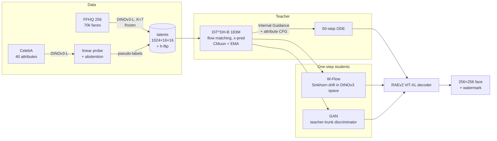

# HumanDiT: controllable synthetic faces in DINOv3 space

   

A 256×256 face generator you can steer with attributes (smile, glasses, beard, hair, age, …). It is built from
the newest published methods at every stage, and every result below is measured by scripts in this repo.

| Stage | What | Why it matters |
|---|---|---|
| **Latent space** | [RAEv2](https://arxiv.org/abs/2605.18324) (Jun 2026): frozen **DINOv3-L** features (layers 11–23, K=7) + a ViT-XL pixel decoder | Diffusion happens in a *semantic* representation space rather than a VAE's, which RAEv2 shows converges ~10× faster |
| **Generator** | DiT^DH (trunk + wide DDT head), x-prediction flow matching, dimension-shifted logit-normal timesteps | The architecture RAEv2 uses for high-dimensional (1024-ch) latents |
| **Guidance** | [Internal Guidance](https://arxiv.org/abs/2512.24176): an auxiliary head at block 4 acts as the "weak model" | Guidance with no extra network and no extra forward pass; works unconditionally |
| **Optimiser** | [CMuon](https://arxiv.org/abs/2608.02502) (Aug 2026): Muon with *chunked* Polar-Express orthogonalisation of fused adaLN weights | Implemented from the paper's algorithms (no public code) and unit-tested |
| **Control** | One token per attribute (unspecified / absent / present), attribute CFG | Any subset of attributes can be requested; "all unspecified" is the unconditional model |
| **Computer vision** | DINOv3 linear-probe labeller trained on CelebA, with **calibrated abstention** | Pseudo-labels FFHQ, then scores the generator's own outputs *in latent space* |
| **One step** | [W-Flow](https://arxiv.org/abs/2605.11755) (May 2026) **vs** adversarial post-training (the GAN), head-to-head | ~50× fewer network evaluations; interactive on a 4 GB laptop GPU |
| **Responsibility** | Memorisation audit against all 70k training faces, invisible watermark, model card | Faces of real people are sensitive, so this is measured rather than assumed |

## Results

<!-- RESULTS:START -->
_Results will appear here after the RunPod run._
<!-- RESULTS:END -->

## How it works



## Engineering notes (all measured)

- **The laptop GPU dictated the precision policy.** On the GTX 1650 Ti (TU117, sm_75), fp16 GEMM runs at
  **0.41 TFLOPS vs 1.72 in fp32** (no tensor cores), and bf16 is emulated. The code runs fp32 on sm_75 and bf16 +
  `torch.compile` on Ampere and newer. See [docs/hardware_notes.md](docs/hardware_notes.md).
- **Decoder rewrite:** the RAEv2 pixel decoder is re-implemented with SDPA attention. It loads the released weights
  strictly and matches the reference to **2.4e-7** max abs error.
- **Reconstruction gate before spending money:** the released "general" decoder reconstructs FFHQ faces at PSNR
  27.2 dB / LPIPS 0.033 (500 images on the laptop). No face-specific decoder fine-tuning was needed.
- **Budget-aware training:** the trainer measures its own step time and fits the run to a dollar budget.
  Gradient accumulation backs off automatically on OOM, and every stage of the RunPod pipeline is idempotent and resumable.
- **W-Flow adaptation:** the paper computes OT drift in MAE feature spaces. Here the RAEv2 latent *is* a DINOv3
  representation, so the multi-scale drift (tokens, 2×2 and 4×4 pools, global statistics) runs directly on
  generator outputs with no extra feature network. The loss is ported from the official MIT implementation.

## Reproduce

```bash
uv sync --extra eval --extra demo                      # Python 3.14, torch 2.14 (cu130)
uv run pytest                                          # unit tests (CPU)
uv run python scripts/rae_reconstruction_gate.py --n 500
uv run python scripts/prepare_data.py ffhq --shards 1 --limit 1024
uv run python scripts/train.py configs/laptop_smoke.yaml           # 4 GB smoke test
DRY_RUN=1 bash scripts/pod/run_all.sh                  # whole pipeline on tiny data
# on a rented GPU: everything, fitted to a budget, resumable
BUDGET_USD=4 USD_PER_HOUR=0.34 AUTO_STOP=1 bash scripts/pod/run_all.sh
uv run python app/gradio_app.py                        # live demo
```

## Before → after

| | Original project | HumanDiT |
|---|---|---|
| Model | DCGAN (2015), 64×64 | RAEv2 latent diffusion transformer, 256×256 |
| Control | none | 12 face attributes, any subset |
| Sampling | 1 step (GAN) | 50-step teacher **and** 1-step students |
| Evaluation | none | FID, FD_DINOv2, precision/recall, controllability, memorisation |
| Engineering | one script, duplicated folder, CPU-only torch | package, tests, CI, resumable budgeted cloud pipeline |

The original code is preserved in [`legacy/`](legacy/), and [`legacy/README.md`](legacy/README.md) explains its flaws. One example:
its "latent consistency" loss penalised output differences between nearby latents, which *encourages* mode collapse.

## Limitations (honest)

- FFHQ is skewed in age, ethnicity and photographic style, and the generator inherits that skew. Attribute labels are
  CelebA-derived pseudo-labels (e.g. a binary "Male" label), so they are a simplification.
- Results are not SOTA: the best published FFHQ-256 FIDs are ~2–3 from far larger compute budgets.
- The W-Flow student is a new adaptation (latent-space drift, teacher initialisation) rather than the paper's exact setup.

## Licences

The code is MIT (see [LICENSE](LICENSE)); files adapted from RAEv2 keep their **CC BY-NC 4.0** notice. Trained
weights inherit **non-commercial** terms from FFHQ (CC BY-NC-SA 4.0), RAEv2 (CC BY-NC 4.0) and DINOv3 (DINOv3 License).
See [MODEL_CARD.md](MODEL_CARD.md).
