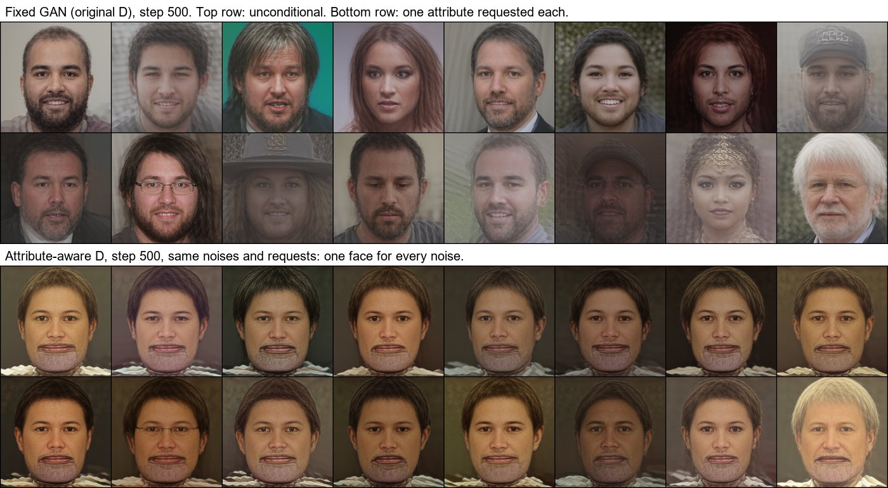

# Why the one-step GAN lost facial hair, and a fix that failed

The fixed GAN student (FID-50k 20.0) was the best one-step model on image statistics. But asked for a goatee,
sideburns or a beard, it drew them 0%, 10% and 11% of the time, where the teacher and W-Flow manage 98%–100%. This
page records how the cause was found and what was changed. The diagnosis reused existing checkpoints and logs. The
fix was then checked by training only the discriminator's heads (15 min on an A100) before any student was
retrained. The cause is now measured (section 4). The fix passed its check but collapsed the student in training, so
it was stopped at step 500 (section 5). The GAN's facial-hair limitation stands.

All rates are the DINOv3 probe's verdict on generated latents (`p > 0.5`), with the other attributes left
unspecified. That is the same test as the README's control table.

## 1. When did it happen? The saved training samples

Every 500 steps the trainer saves the EMA student's output for 16 fixed noises. Rows 11–13 of those samples request
Goatee, Sideburns and Beard alone. Scoring them with the probe gives a timeline, for free:

| Goatee requested → drawn | step 500 | step 1,000 | step 1,500 | end (2,053) |
|---|---|---|---|---|
| GAN, 2nd attempt (discriminator noise bug) | 1.00 | 1.00 | 0.35 | 0.02 |
| GAN, fixed (3rd attempt) | 1.00 | 0.90 | 0.17 | 0.04 |
| W-Flow | 1.00 | 1.00 | 1.00 | 1.00 |

Both GAN runs start with the teacher's facial hair and lose it between steps 1,000 and 1,500. The discriminator
noise-level fix did not cause it: the run before that fix shows the same collapse.

## 2. What exactly was lost? `scripts/control_diagnosis.py`

64 samples per request, same noise for every model:

| Request | fixed GAN: Goatee / Male | W-Flow: Goatee / Male | teacher, the anchors' setting*: Goatee / Male |
|---|---|---|---|
| Goatee | 0.00 / 0.44 | 1.00 / 0.98 | 0.98 / 1.00 |
| Goatee + Male | 0.05 / 0.91 | 1.00 / 1.00 | 0.97 / 1.00 |
| Beard + Male (Beard) | 0.55 | 1.00 | – |
| unconditional (Male) | 0.38 | 0.44 | 0.48 |

\* IG 1.78, no CFG, 25 steps: exactly how the GAN's 6,144 anchor pairs were made.

- **Not a missing "goatee implies male" link:** with Male also requested, the faces are male (91%) and still
  clean-shaven (5% goatee).
- **Not the anchors:** the teacher, run the way the anchors were made, draws a goatee 98% of the time.
- **Not the probe:** the same probe sees W-Flow's and the teacher's facial hair.

## 3. Why? The training logs

The discriminator's loss sat at 1.386 = 2 ln 2 from the first logged step to the last, with its scores on real and
generated latents equal throughout. It never learned to separate them, and it had no way to check the requested
attributes: its heads read only the image tokens, and it was never shown a face under the wrong attributes. The
anchor loss fell steadily (0.99 → 0.58), so the student was mostly regressing onto the anchors plus a
discriminator gradient that did not care about attributes. Facial hair is fine, male-specific texture: the kind of
detail a weak, attribute-blind discriminator lets a one-step generator drop.

That last step is an inference. The measured facts are sections 1–3, and the check below tests the inference
directly.

## 4. The attempted fix, checked before training: `scripts/check_discriminator.py`

**The fix: an attribute-aware discriminator** (`--d-attr-heads --d-mismatch 1`).
- **Heads on the attribute tokens:** each attribute token attends to the image in every trunk block, so a head on it
  can judge whether its state fits the face.
- **The matching-aware term** of Reed et al. (2016): a real latent under a condition with one specified attribute
  flipped counts as fake.

Together these give the discriminator a reason, and a way, to penalise "goatee requested, none drawn".

**The gate, before the student was trained again:**
1. Train only the discriminator heads (student frozen at initialisation), for the original and the new design.
2. On 2,048 held-out real latents, measure how often D prefers each face's true attributes over the same face with
   one attribute flipped.
3. The Colab driver trains the student only if the new D reaches 75% on goatee/sideburns/beard (chance is 50%).

Result (`runs/eval/discriminator_check.json`, 600 head-only steps each, 2,048 held-out latents; the "correct" rate
is the share of pairs where D scores the true attributes above the one-flip version, with ties counted as half):

| D | noise t | Goatee | Sideburns | Beard | facial hair | all 12 attributes | real vs one-step fake |
|---|---|---|---|---|---|---|---|
| original (image heads only) | 0.1 | 0.28 | 0.82 | **0.10** | 0.40 | 0.60 | 1.00 |
| original (image heads only) | 0.4 | **0.06** | 0.30 | **0.13** | 0.17 | 0.51 | 1.00 |
| attribute-aware | 0.1 | 0.95 | 0.93 | 0.90 | **0.93** | 0.73 | 1.00 |
| attribute-aware | 0.4 | 0.93 | 0.92 | 0.90 | **0.92** | 0.73 | 1.00 |

- **The original D is worse than blind on facial hair.** Given a real face and its true Beard label, it prefers the
  flipped label 90% of the time at t = 0.1 (Goatee: 72%, and 94% at t = 0.4). A D that systematically rates the
  contradicting label as more "real" gives the student no reward for drawing what was asked, and plausibly a reward
  for the opposite. That matches the collapse in sections 1–2. It is still indirect: D's label preference on a fixed
  face is not the same thing as its gradient on the student's image, so the retrain below is the real test.
- **The attribute-aware D gets facial hair right 92–93% of the time** at both noise levels, so the gate passed
  (worst t: 0.917 against the 0.75 bar) and the driver started the student.
- **It is not better everywhere.** It gets Hat (0.31–0.33), Lipstick (0.32–0.36) and Mouth Open (0.39) below
  chance, where the original D managed 0.57–0.80.
- Both Ds separate real latents from the untrained one-step student's output perfectly, so "real vs fake" is not
  what distinguishes them. Attribute matching is.

## 5. The retrain: collapsed by step 375, stopped at 500. The gate did not catch it.

The student ran with the attribute-aware D (`--d-attr-heads --d-mismatch 1`), otherwise exactly as the fixed GAN
(same anchors, batch, learning rates). Every 125 steps it logged how often the probe finds an attribute when that
attribute alone is requested (64 fixed noises), plus the male rate of unconditional samples:

| step | unconditional: male | Goatee | Sideburns | Beard | Male | Eyeglasses |
|---|---|---|---|---|---|---|
| 125 | 0.53 | 1.00 | 1.00 | 1.00 | 0.94 | 1.00 |
| 250 | 0.81 | 1.00 | 1.00 | 1.00 | 0.97 | 1.00 |
| 375 | **1.00** | 1.00 | 1.00 | 1.00 | 1.00 | 0.98 |
| 500 | **1.00** | 1.00 | 1.00 | 0.98 | 1.00 | **0.63** |

The teacher's unconditional male rate is 0.48 (section 2). The run was stopped at step 500 (22 min of training, after 8 min
making anchors) instead of spending the remaining ~65 min and a 50k-sample evaluation.

**What the student drew at step 500:** one face. The decoded training samples (16 fixed noises: 8 unconditional, 8
requesting one attribute each) show the same goateed man with the same collar for every noise. Only glasses and grey
hair appear where requested. The fixed GAN at the same step, with the same noises, was diverse. So "facial hair
100%" meant that every face had facial hair, not that the requests were followed.

**Why, from the training log** (`metrics.jsonl`, 21 logged steps):
- **D never told a matched condition from a flipped one during training.** Its mean logit on real latents under
  their true attributes and under one flipped attribute differ by at most 0.009 at every logged step. On average
  the flipped ones scored higher, by 0.0006.
- **So the matching-aware term cancelled the real-data term.** At weight 1 it asks D to call the same real latents
  fake. D's loss stayed at 2.0–2.26, about 3 ln 2 = 2.08 (chance for its three terms). At all 21 logged steps, D
  scored the student's output *above* real data (`d_fake > d_real`).
- **With no usable signal from D,** the only other force was the anchor regression, and the student collapsed to a
  single mode.

**Why the gate passed anyway.** It measured *ranking* (does D score the true attributes above the flipped ones?),
not *margin*. It also trained D against a frozen student, which it separated from real data perfectly. 92% ranking
accuracy with a near-zero margin is exactly what this run showed. The part that failed, the joint D/student
dynamics, is something a D-only check cannot see.

**Where that leaves the GAN student:** the fixed GAN (3rd attempt) stays the demo's one-step model, with its
facial-hair limitation stated. The cause of that limitation is measured (section 4: its D prefers the contradicting
facial-hair label). This attempt at a fix is a documented negative result.
