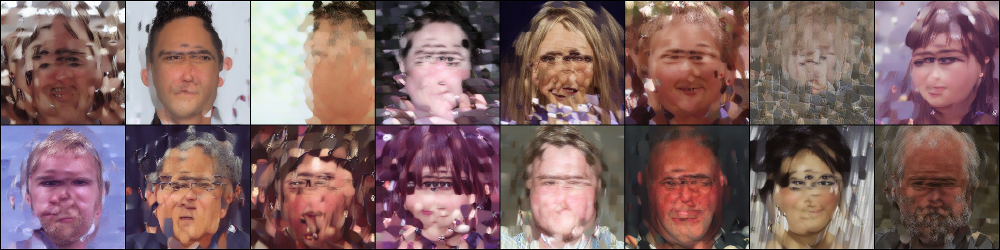
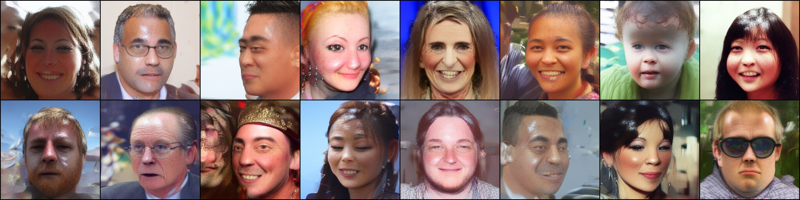
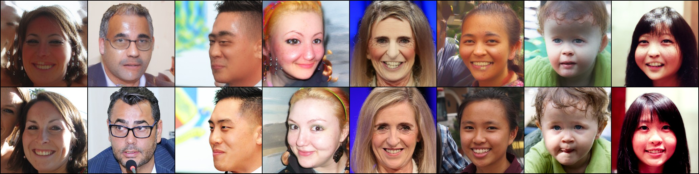
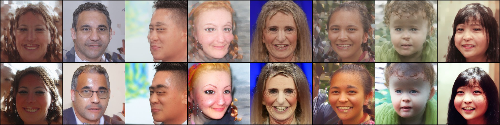
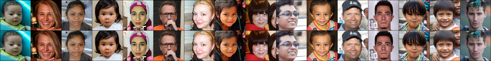

# Laptop smoke test (GTX 1650 Ti, 4 GB)

**Goal:** prove that the full stack works on real data before spending money on a cloud GPU. The stack is DINOv3/RAEv2 latents, the DiT^DH generator, flow matching, CMuon, Internal Guidance, EMA and the RAEv2 decoder.

**Setup:** DiT^DH-S (65.1M params), fp32 with gradient checkpointing (1.7 GB), **256** FFHQ faces plus horizontal flips,
batch 16, 2,000 steps (32k samples), 1.84 h at about 6 img/s.

| step 1,000 | step 2,000 (EMA, Internal Guidance 1.78, 50 Euler steps) |
|---|---|
|  |  |

## Is it memorising? Yes, as a 256-image overfit test should

In DINOv3 space (pooled RAEv2 latents), each generated face has cosine similarity **0.90** (median) to its nearest
training face. By comparison, *distinct* real training faces reach only **0.70** (median) and **0.83** (99th percentile).
They are not pixel copies: full-latent similarity peaks at 0.77, where an identical image is about 1.0. The pairs
show the same pose, framing and style, but mostly different people:

This is the same audit that `scripts/evaluate.py` runs on the full-data model against all 70k training faces.

## Internal Guidance helps

The same noise is shown without guidance (top) and with Internal Guidance at scale 1.78 (bottom). Guidance sharpens
eyes, glasses, freckles and teeth and removes background artifacts, at the cost of slightly oversaturated skin in a
few samples. The scale is tuned during evaluation.

## RAEv2 decoder on faces (before any training)

Real FFHQ faces (top) are encoded by frozen DINOv3-L and decoded by the released RAEv2 "general" decoder (bottom), giving
PSNR 27.2 dB and LPIPS 0.033 over 500 images:

